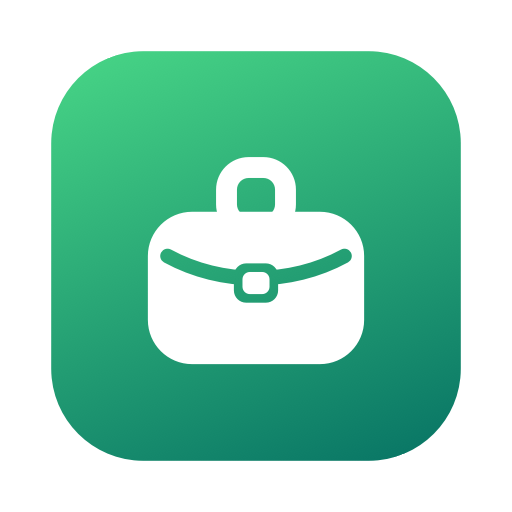
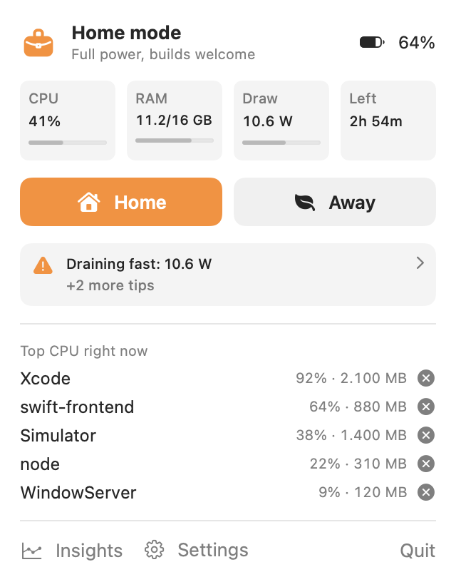
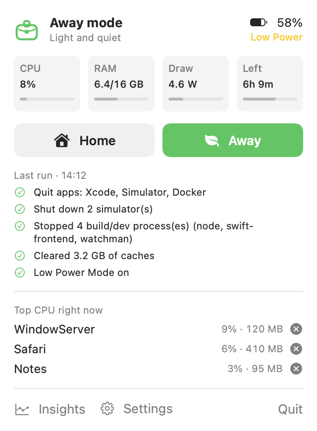
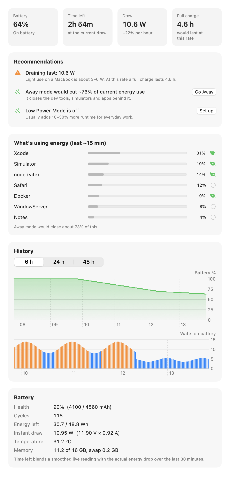
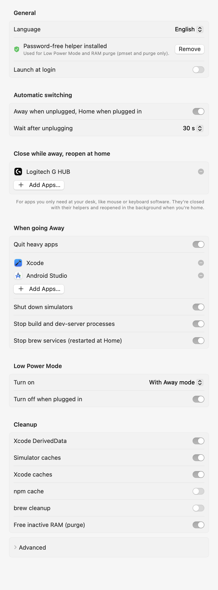

<p align="center">
  
</p>

<h1 align="center">Packlight</h1>

<p align="center">
  <b>Home / Away modes for developer MacBooks.</b><br>
  Unplug, and the builds, simulators and background apps you only need at your desk close themselves.<br>
  Plug back in, and everything comes back.
</p>

<p align="center">
  
  &nbsp;&nbsp;
  
</p>

---

At your desk you want the Mac at full power: Xcode, simulators, Docker, dev servers, brew services, peripheral
software. Out and about you want it light, quiet and lasting all day. Packlight switches between the two with one
click — or automatically when you unplug — and tells you exactly what is eating your battery.

## Features

### Away mode
Runs when you unplug (after a cancellable countdown) or with one click:

- **Quits heavy apps politely** — Xcode, Simulator, Android Studio, Docker, OrbStack, or any list you choose.
  Apps are asked to quit, never force-quit, so unsaved work still prompts.
- **Shuts down simulators and stops build / dev-server processes** — xcodebuild, swift, cargo, Gradle, Vite, Next,
  Metro, watchman, stray `caffeinate`… Matching is by explicit patterns, so editors, MCP servers and AI tools keep running.
- **Close while away, reopen at home** — for things you only need at your desk (e.g. mouse/keyboard software like
  Logitech G HUB). The app and every helper process inside it are closed, then restarted in the background through
  the app's own LaunchAgent when you're back.
- **Pauses Homebrew services** and restarts exactly those at home.
- **Cleans up** DerivedData, simulator and Xcode caches (npm cache and `brew cleanup` optional).
- **Frees inactive RAM and turns on Low Power Mode.**

### Battery insights

<p align="center">
  
</p>

- **Real power draw in watts**, read straight from the battery controller (voltage × current)
- **Time-left forecast** that blends a smoothed live reading with the real energy drop over the last 30 minutes
- **What's using energy**, grouped per app (browser helpers count as the browser) — and how much of it Away mode would close
- **Recommendations with one-click fixes**: switch to Away, add an app to the Away list, turn on Low Power Mode, plus
  hints for heavy browser tabs, the display, Spotlight indexing, heat, memory pressure and battery health
- 48 hours of history, battery health and cycle count, CPU / RAM / swap at a glance

### Settings

<p align="center">
  
</p>

Every step can be switched off, and every list (apps to quit, apps to reopen at home, extra process patterns) is editable.

### Languages
Follows your Mac's language, or pick one in Settings: English, Türkçe, Español, 简体中文, हिन्दी, العربية,
Français, Português (Brasil), Deutsch, 日本語, Русский, 한국어 (right-to-left layout for Arabic).

## Install

Requires macOS 15 or later and the Xcode command line tools (`xcode-select --install`).

```bash
git clone https://github.com/efeshinkawa/packlight.git
cd packlight
./build.sh
```

`build.sh` builds `Packlight.app`, installs it to `~/Applications` and launches it. The app is ad-hoc signed,
not notarized: if macOS blocks it, right-click it in Finder → Open once.

Then, from the menu bar icon:

1. **Install password-free helper** (asks for your admin password once). Low Power Mode and RAM purge need root;
   this writes `/etc/sudoers.d/packlight` (validated with `visudo`) allowing *only* `pmset -a lowpowermode 0|1`
   and `purge` for your user. Remove it any time in Settings.
2. **Settings → Launch at login.**
3. Optional: add apps you only use at your desk to **Close while away, reopen at home**.

## Raycast extension

Control Packlight without touching the menu bar. The extension lives in [`raycast/`](raycast/):

```bash
cd raycast
npm install
npm run dev     # imports it into Raycast; it stays installed afterwards
```

| Command | What it does |
| --- | --- |
| **Go Away** | Runs Away mode and shows what was closed in a HUD |
| **Go Home** | Back to full power: Low Power off, services and apps restarted |
| **Toggle Home / Away** | Flips between the two — handy on a hotkey |
| **Battery Forecast** | Time left, power draw, health, top energy users and current recommendations; opens the Insights window |
| **Packlight Settings** | Every toggle, list and the language, editable right in Raycast |

The extension talks to the app through its URL scheme and reads the forecast the app publishes, so the app must be installed.

## URL scheme

Use these from Shortcuts, scripts or other launchers:

| URL | Action |
| --- | --- |
| `packlight://away` · `packlight://home` · `packlight://toggle` | switch modes |
| `packlight://cancel` | cancel a pending unplug countdown |
| `packlight://insights` · `packlight://settings` | open a window |
| `packlight://set?key=lowPower&value=false` | change a setting |

## How the forecast works

Every minute Packlight reads the `AppleSmartBattery` registry entry (no root needed): voltage, instant current,
remaining and full capacity. Draw is `|V × I|`, smoothed with an exponential moving average and averaged with the
measured energy drop (Wh) of the current unplugged stretch over the last 30 minutes, which is steadier than any
single reading. Time left is `remaining Wh ÷ average W`. Per-app energy comes from `top`'s energy-impact column,
grouped by app bundle and decayed so the list reflects roughly the last 15 minutes.

## Privacy and safety

- No network access, no analytics. Battery history stays in `~/Library/Application Support/Packlight`.
- Only regenerable build caches are deleted.
- Root is used for exactly two commands, through a sudoers rule you install and can remove.

## Development

```bash
swift build
.build/debug/Packlight --snapshot /tmp/shots          # render the panel and windows to PNGs
.build/debug/Packlight --snapshot /tmp/shots --demo   # same, with sample data (used for these screenshots)
```

Sources live in `Sources/Packlight`: `Actions.swift` (what the modes do), `Insights.swift` (battery, energy,
recommendations), `MenuView.swift` / `InsightsView.swift` (UI), `Translations.swift` (all languages),
`MenuBarIcon.swift` (the icon, drawn in code). Issues and pull requests are welcome — translation fixes especially.

## License

[MIT](LICENSE) © Efe Erim
